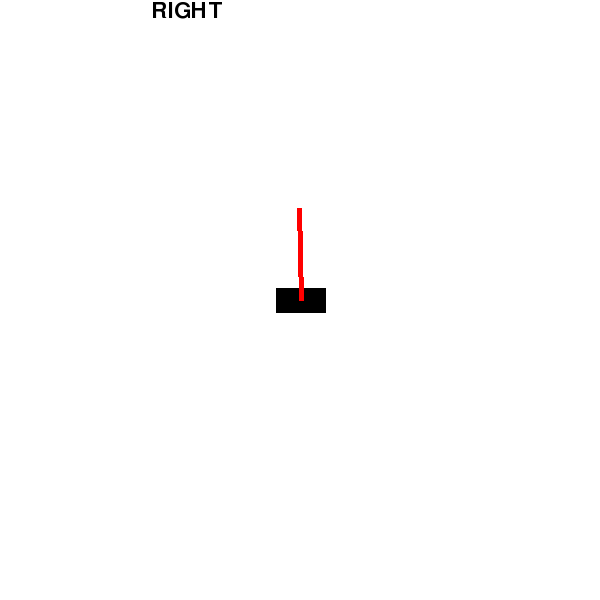

# CartPoleRL

<table>
  <tr>
    <td></td>
  </tr>
</table>

Custom "OpenAI gym"-like environment and agent creation platform for RL training.  
Currently supports a cart-pole environment with a Q-Learning (Q Table) agent.

Python Version: 3.14  
Requires uv (e.g. through `pip install uv`)

## Getting started:

- Before running anything:
  - `git clone git@github.com:TimoJammes/CartPoleRL.git && cd CartPoleRL`
  - `uv sync` get project dependencies

- Example runs (see CLI flag list below):
  - `uv run cartpolerl` see an agent training in real time.
  - `uv run cartpolerl --save --headless --name run1 --episodes 1000` train an agent and save the run under training_runs/run1
  - `uv run cartpolerl --watch --load training_runs/run1` load and watch a trained agent using its learned policy

- during training with the GUI (e.g. `uv run cartpolerl`), press ESC to pause/unpause the rendering (to speed up training), e.g. to skip over episodes to see agent progress faster.

- tune your environment, agent, task, physics and display configs in `src/cartpolerl/config.py`

## CLI flags:

options:

- `-h, --help`: show this help message and exit
- `--headless`: run training without the GUI (faster)
- `--human`: Override agent for user input (left/right)
- `--save`: save the run to when training is terminated
- `--run-dir RUN_DIR`: folder for saved runs, relative to the current directory
- `--load RUN_DIR`: continue from (or watch) a saved run
- `--watch`: with --load: show the greedy policy (epsilon=0, no learning, no saving)
- `--epsilon EPSILON`: override the agent's exploration rate
- `--fail-angle FAIL_ANGLE`: override the pendulums's episode-ending angle. -1 for no fail (in deg)
- `--episodes EPISODES`: override the simulation's # of episodes
- `--name NAME`: override the run's save name

`notebooks/run_analysis.ipynb` allows to analyze a run by looking at the episode outcome over training time (FAIL vs max steps exceeded) and look at rewards over episode steps over training episodes.